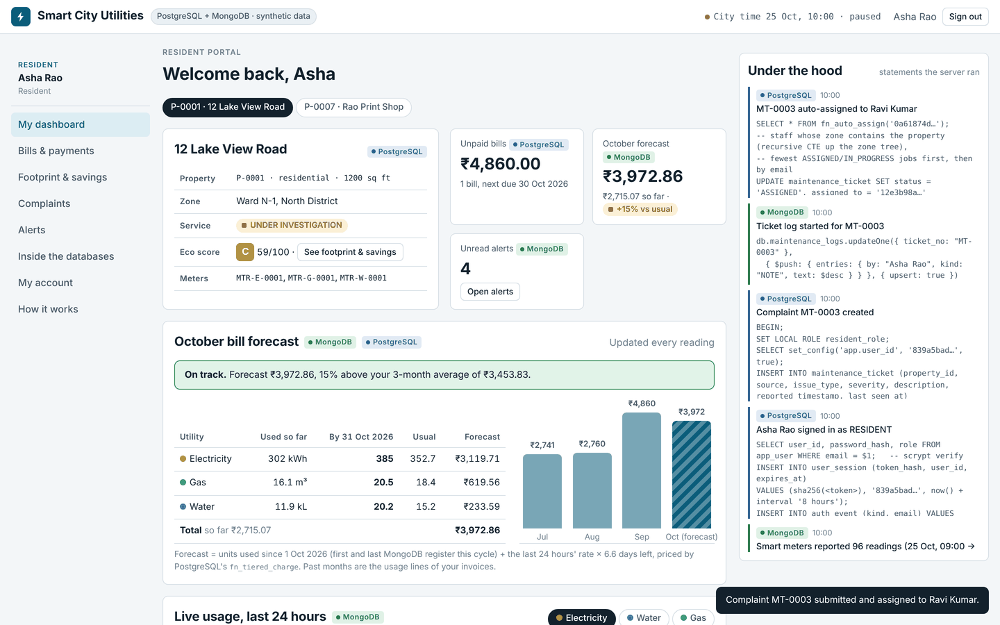
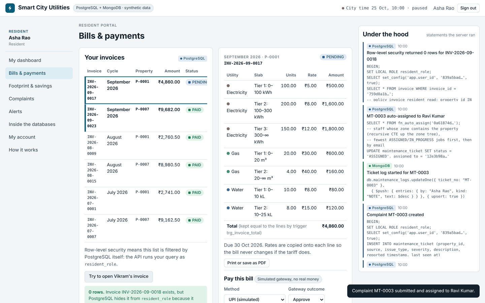
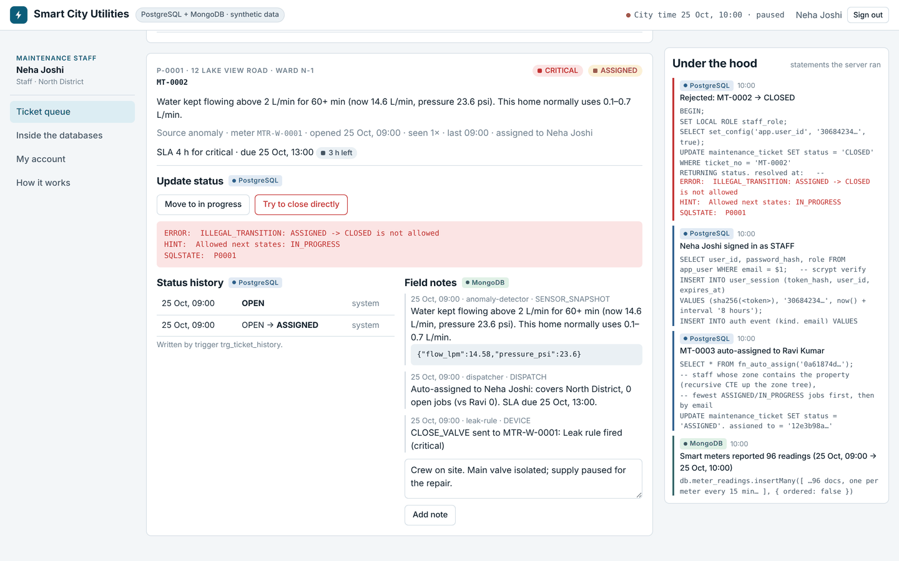
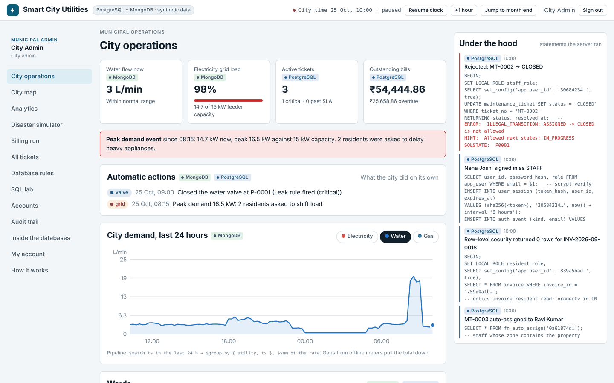
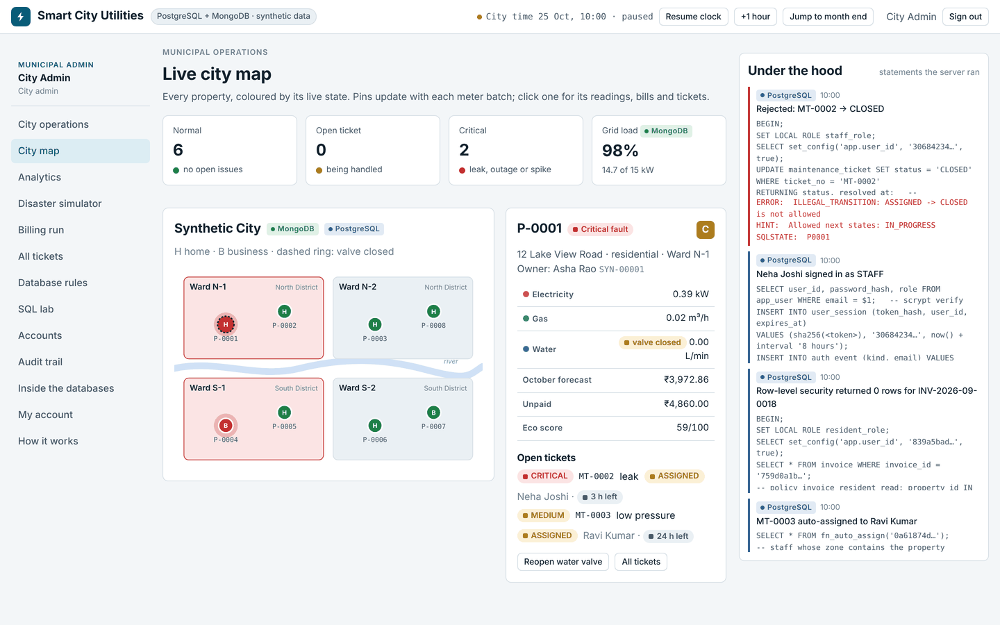
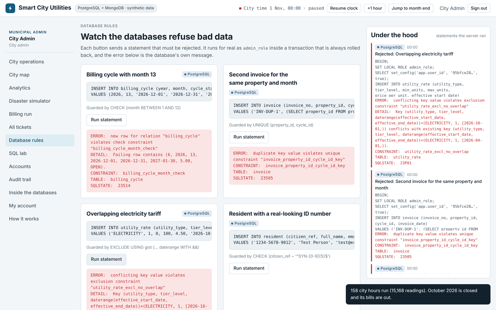
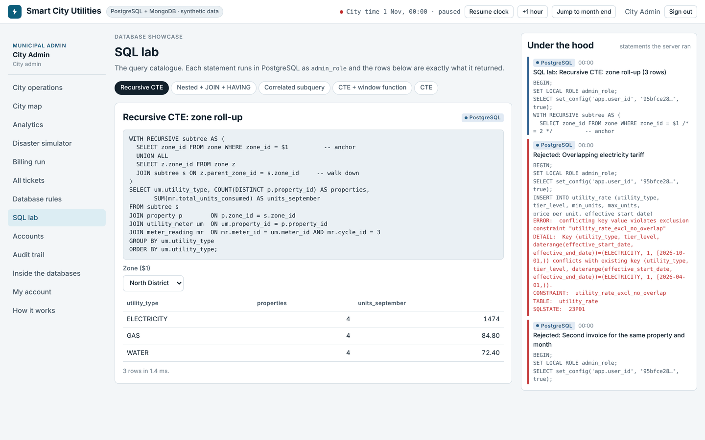
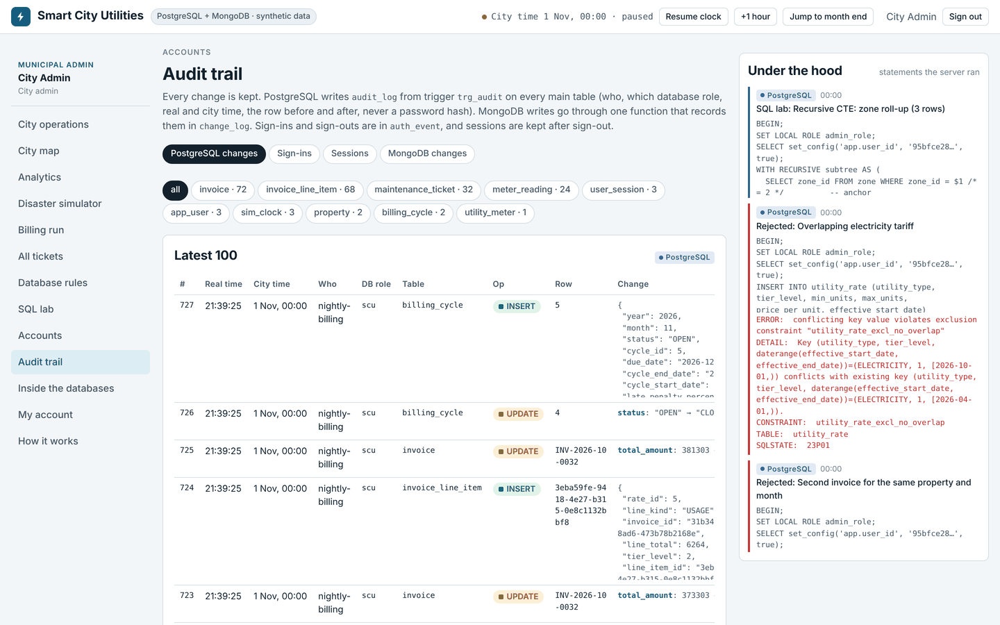
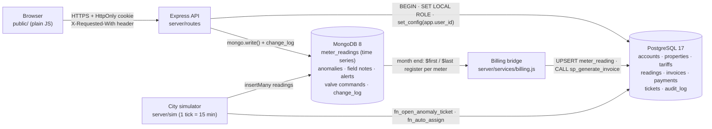
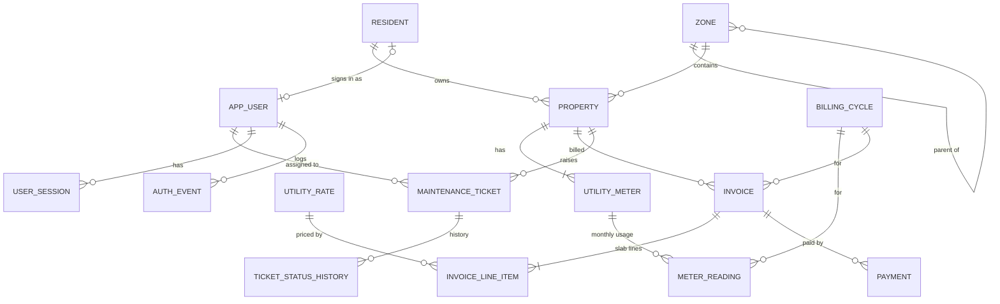

# Smart City Utilities & Infrastructure Management

**Electricity, water and gas for a whole (synthetic) city, run on two real databases.**
Smart meters stream readings into **MongoDB 8**, faults turn into repair tickets in **PostgreSQL 17**, engineers fix them, and every month the readings become slab-priced bills. Residents, maintenance staff and city admins sign in with real accounts, and PostgreSQL's row-level security decides what each of them can see.


<p align="center"></p>

**Contents:** [Features](#features) · [Screenshots](#screenshots) · [Quick start](#quick-start) · [Demo accounts](#demo-accounts) · [Demo script](#demo-script-about-10-minutes) · [Architecture](#architecture) · [Data model](#data-model) · [DBMS concepts and where to find them](#dbms-concepts-and-where-to-find-them) · [Security](#security) · [Tests](#tests) · [Project layout](#project-layout) · [Configuration](#configuration) · [Troubleshooting](#troubleshooting)

---

## Features

| For | What they can do |
|---|---|
| **Residents** | Live meter charts, a bill forecast for the running month, bills with slab-by-slab lines, simulated payments (safe to retry), carbon footprint and eco score compared with similar homes, complaints, alerts, switching a supply off for an empty home |
| **Maintenance staff** | A ticket queue for **their own district only**, taking jobs, moving tickets through a strict state machine, field notes, resolving (which reopens a closed water valve) |
| **City admins** | City operations dashboard, live map, analytics with CSV export, a disaster simulator (pipe burst, electricity spike, ward outage), the month-end billing run, account management, the full audit trail, a "Database rules" page and an SQL lab |
| **Everyone** | **Inside the databases** (browse the real tables and collections, filtered by your own permissions), **My account** (password, sessions, sign-in history) and **How it works** |

What the city does by itself:

- **Fault detection:** a leak (water flowing non-stop for an hour), a power spike (3× the meter's own baseline) or an offline meter opens **one** ticket per fault, never duplicates.
- **Smart dispatch:** each new ticket goes to the engineer covering that area with the fewest open jobs (a recursive CTE up the zone tree).
- **Smart valve:** a leak closes the property's water valve, and resolving the ticket opens it again.
- **Peak demand response:** above 90% of grid capacity, residents are asked to shift load.
- **SLA escalation, high-bill warnings and a nightly job** that marks unpaid bills overdue and adds a 5% late fee once.

All people, addresses, emails and ID numbers are made up (`SYN-00001`, `@example.test`). The database rejects anything that is not a synthetic ID.

## Screenshots

| | |
|---|---|
|  **Bills:** ₹4,860 from the tariff slabs; another resident's invoice returns 0 rows |  **Staff queue:** the trigger refuses an illegal status jump |
|  **City operations:** live demand from MongoDB, money and tickets from PostgreSQL |  **City map:** a burst pipe turns the property red and closes its valve |
|  **Database rules:** both databases refusing bad data |  **SQL lab:** recursive, correlated, window and `HAVING` queries |
|  **Audit trail:** every change, who made it, from which role, before and after | |

## Quick start

You need [Node.js 20.11+](https://nodejs.org) and [Docker](https://docs.docker.com/get-docker/).

```bash
git clone https://github.com/dhanushshekhar13-alt/smart-city-utilities.git
cd smart-city-utilities
cp .env.example .env        # choose your own POSTGRES_PASSWORD and use the same one in DATABASE_URL
npm install
npm run db:up               # PostgreSQL 17 + MongoDB 8 in Docker; files live in ./data
npm run setup               # tables, functions, triggers, roles, collections and the demo city
npm start                   # open http://localhost:8080
```

Everything you do in the app is written to `data/postgres` and `data/mongo` and survives a restart. `npm run reset` drops both databases and loads the demo city again.

<details>
<summary><b>Without Docker</b></summary>

Install PostgreSQL 15+ and MongoDB 7+ yourself, create an empty database, put both connection strings in `.env` (`DATABASE_URL`, `MONGO_URL`), then run `npm run setup` and `npm start`. The PostgreSQL user must be allowed to create roles, because setup creates `resident_role`, `staff_role` and `admin_role` for row-level security.
</details>

### Commands

| Command | What it does |
|---|---|
| `npm run db:up` / `npm run db:down` | Start or stop the database containers |
| `npm run setup` | First-time setup (does nothing if the tables already exist) |
| `npm run reset` | Drop both databases and load the demo city again |
| `npm start` / `npm run dev` | Run the server (`dev` restarts on file changes) |
| `npm test` | 26 integration tests against separate `*_test` databases |
| `npm run export` | Every table to CSV and every collection to NDJSON in `data/export/` (secrets left out) |

## Demo accounts

Every demo account uses the password **`demo123`**.

| Who | Email | Role |
|---|---|---|
| Asha Rao | `asha@example.test` | Resident (home P-0001 and shop P-0007) |
| Vikram Iyer | `vikram@example.test` | Resident (two properties) |
| Ravi Kumar | `ravi.staff@city.example.test` | Staff, North District |
| Neha Joshi | `neha.staff@city.example.test` | Staff, North District |
| Kavya Shetty | `kavya.staff@city.example.test` | Staff, South District |
| City Admin | `admin@city.example.test` | Municipal admin |

Meera, Rahul, Fatima and Arjun are on the city register but have no account yet; they can use **Create an account** (for example `meera@example.test`). Five wrong passwords lock an account for 15 minutes, sessions last 8 hours, and `DEMO_MODE=false` hides the demo cards.

## Demo script (about 10 minutes)

Use two browser windows (one normal, one private) so the admin can stay signed in while you switch between Asha and Neha. If the clock moves too fast while you talk, press **Pause clock** as the admin and use **+1 hour**.

1. **Asha → My dashboard.** Property from PostgreSQL, live meters from MongoDB, and the forecast combines both.
2. **Asha → Bills & payments.** September bill `INV-2026-09-0017` is **₹4,860** (electricity 100 × ₹5 + 200 × ₹8 + 150 × ₹12). **Try to open Vikram's invoice** returns **0 rows**: row-level security.
3. **Admin → Disaster simulator → Start pipe burst**, then **+1 hour** twice. A CRITICAL leak ticket goes to **Neha** (she and Ravi both had 0 jobs; the tie goes by email). On the **City map** Asha's pin is red and her valve has closed.
4. **Start electricity spike**, then **+1 hour.** Kavya gets a spike ticket, and **City operations** shows a peak demand event.
5. **Asha → Complaints.** The complaint goes to **Ravi**, who now has fewer open jobs.
6. **Neha → the leak ticket.** **Try to close directly** is refused with `ILLEGAL_TRANSITION`. Move it to in progress, add a note (MongoDB), and resolve with notes: the valve reopens.
7. **Admin → Jump to month end.** About 15,000 readings are generated, October is closed and 8 invoices are created from MongoDB readings. Asha's unpaid September bill gets the late fee and becomes **₹5,103**.
8. **Asha → pay the overdue bill → Send the same request twice.** One idempotency key, one stored payment.
9. **Admin → Audit trail, Database rules, SQL lab, Inside the databases.** Proof that it is all real.

## Architecture



**Why two databases?** PostgreSQL holds everything that needs rules and money: constraints, transactions, triggers and row-level security. MongoDB holds the high-volume sensor data, whose shape differs per utility, in a time-series collection, plus flexible documents such as a ticket's field log.

**One request, end to end:** the browser sends the session cookie and the CSRF header → `csrfGuard` → `attachUser` (cookie SHA-256 → `user_session` → `app_user`) → `requireRole` → a transaction with `SET LOCAL ROLE resident_role | staff_role | admin_role` and `app.user_id` → PostgreSQL policies filter every row and `trg_audit` records every write → COMMIT, or ROLLBACK on any error.

**Month end:** an aggregation pipeline takes the first and last cumulative register of each meter in the month → one `meter_reading` row per meter (UPSERT, one SAVEPOINT per meter) → `sp_generate_invoice` prices it with `fn_tiered_charge` → `trg_invoice_total` keeps the total equal to the lines → the next cycle opens and residents are notified.

## Data model



18 PostgreSQL tables and 8 MongoDB collections. Full column-by-column notes are in [docs/database.md](docs/database.md).

| MongoDB collection | Holds | Guarded by |
|---|---|---|
| `meter_readings` | every 15-minute reading (time series, bucketed by meter) | ingestion checks in `validateReading()` (time-series collections cannot have a validator) |
| `anomaly_events` | one open event per fault, with a hit count; doubles as the outbox | `$jsonSchema`, index on `{ key, status }` |
| `maintenance_logs` | one document per ticket with an array of entries | `$jsonSchema`, unique `ticket_no` |
| `notifications` | resident alerts | `$jsonSchema`, partial unique `ref` (send once) |
| `device_commands` | valve commands and acknowledgements | `$jsonSchema` (water meters only) |
| `demand_events`, `ingestion_batches`, `change_log` | peak events, ingestion batches, every tracked write | `$jsonSchema` |

## DBMS concepts and where to find them

| Concept | Where |
|---|---|
| Keys, foreign keys, CHECK, UNIQUE, `UNIQUE NULLS NOT DISTINCT` | [`db/postgres/01_schema.sql`](db/postgres/01_schema.sql) |
| **Exclusion constraint** (no overlapping tariffs, `daterange … WITH &&`) | `utility_rate` in `01_schema.sql` |
| **Generated column** (`total_units_consumed = closing − opening`) | `meter_reading` in `01_schema.sql` |
| **Partial unique indexes** (one active ticket per fault, one successful payment per bill) | `01_schema.sql` |
| **Functions and stored procedures** (tariff slabs, invoices, idempotent payment, overdue job, dispatch) | [`db/postgres/02_functions.sql`](db/postgres/02_functions.sql) |
| **Triggers** (ticket state machine, SLA, history, invoice total, locked readings, frozen paid bills, audit) | [`db/postgres/03_triggers.sql`](db/postgres/03_triggers.sql) |
| **Roles, column grants and row-level security** | [`db/postgres/04_security.sql`](db/postgres/04_security.sql) |
| **Recursive CTE** (zone tree down for staff visibility, up for dispatch) | `fn_zone_subtree`, `fn_auto_assign`, SQL lab |
| Correlated subquery, nested subquery with `HAVING`, window functions (`LAG`, `dense_rank`), `LATERAL`, `FILTER` | SQL lab in [`server/routes/db.js`](server/routes/db.js), `fn_peer_usage`, `v_cycle_revenue` |
| **Transactions, savepoints, advisory locks, `SELECT … FOR UPDATE`, `ON CONFLICT`** | [`server/db/pg.js`](server/db/pg.js), [`server/services/billing.js`](server/services/billing.js), `sp_generate_invoice`, `sp_record_payment`, sign-in |
| MongoDB **time-series collection**, `$jsonSchema` validators, indexes | [`server/db/mongo.js`](server/db/mongo.js) |
| MongoDB **aggregation pipelines** (`$match`, `$sort`, `$group` with `$first`/`$last`, `$ifNull`) | billing bridge, bill forecast, city operations |
| Audit trail (trigger with JSON diff, actor and database role) | `trg_audit` in `03_triggers.sql`, `mongo.write()` → `change_log` |

## Security

- **Passwords:** scrypt with a random salt per account, compared in constant time. Five wrong passwords lock the account for 15 minutes (the counter is committed even though the request fails).
- **Sessions:** a random 32-byte token in an `HttpOnly`, `SameSite=Lax` cookie (`Secure` with `SECURE_COOKIES=true`). PostgreSQL stores only its SHA-256. Sign-out, a password change or an admin revoke ends the session in the database.
- **CSRF:** every POST and DELETE must carry `X-Requested-With: smart-city`.
- **Row-level security inside PostgreSQL:** every request runs as `resident_role`, `staff_role` or `admin_role` with its user id, and the policies filter every row. Residents see only their own data, staff only their district, and staff never see money.
- **Secrets:** no app role can read `password_hash` or `token_hash`, and nobody can edit `audit_log`. Credentials live only in `.env`, which is git-ignored.
- **Headers:** Content-Security-Policy (no inline scripts), `X-Frame-Options`, `nosniff`, `no-store` on the API.

## Tests

`npm test` runs 26 integration tests with `node:test` against fresh `*_test` databases, through the real HTTP API.

| File | Covers |
|---|---|
| `tests/auth.test.js` | cookie and hashed token, salted scrypt, sign-out, lockout and unlock, registration, password change, CSRF, role separation |
| `tests/security.test.js` | RLS through the API and in raw SQL, staff district limits, secret columns, read-only audit log, MongoDB alert ownership |
| `tests/billing.test.js` | the ₹4,860 bill and its slabs, locked readings, the state machine, double payment, month end, overdue and late fee |
| `tests/automation.test.js` | burst → ticket → dispatch → valve, complaint dispatch, staff workflow, audit rows under `staff_role`, demand response |

## Project layout

```
db/postgres/      01 schema · 02 functions & procedures · 03 triggers · 04 roles, grants & RLS
server/
  index.js        start-up: connect both databases, start the clock, serve the app
  app.js          Express app, security headers, middleware order
  auth.js         passwords, sessions, cookies, CSRF guard, role checks
  db/             pg.js (transactions as a role) · mongo.js (collections, validators, tracked writes)
  routes/         auth · clock · resident · tickets · admin · db (the JSON API)
  sim/            engine (city clock) · meters · detector (rules) · automation · state
  services/       billing bridge · forecast · eco report · notifications
public/           index.html, css/, js/ (single-page front end, no build step)
scripts/          setup.js · seed.js (synthetic city) · export.js
tests/            integration tests
docs/             architecture.md · database.md · api.md · screenshots/
```

More detail: [docs/architecture.md](docs/architecture.md), [docs/database.md](docs/database.md), [docs/api.md](docs/api.md).

## Configuration

Copy `.env.example` to `.env`. All settings:

| Variable | Default | Meaning |
|---|---|---|
| `POSTGRES_USER`, `POSTGRES_PASSWORD`, `POSTGRES_DB` | `scu`, *(required)*, `smart_city` | used by Docker to create the database |
| `DATABASE_URL` | *(required)* | PostgreSQL connection string for the server |
| `MONGO_URL` | `mongodb://127.0.0.1:27017/smart_city` | MongoDB connection string |
| `PORT` | `8080` | web server port |
| `SESSION_HOURS` | `8` | how long a sign-in lasts |
| `SECURE_COOKIES` | `false` | set `true` behind HTTPS |
| `TICK_MS` | `2000` | real milliseconds per 15-minute city tick |
| `CLOCK_AUTOSTART` | `true` | start with the city clock running |
| `DEMO_MODE` | `true` | show the demo account cards on the sign-in page |

## Troubleshooting

| Message | Fix |
|---|---|
| `DATABASE_URL is not set` | `cp .env.example .env` and fill in the password |
| `connect ECONNREFUSED` | Docker is not running: start it, then `npm run db:up` |
| `The database has no tables yet` | `npm run setup` |
| Numbers differ from the demo script | `npm run reset`, then `npm start` |
| An account is locked | sign in as the admin → **Accounts** → **Unlock**, or `npm run reset` |

## Team

**Dhanush** (PostgreSQL, accounts, row-level security) and **Gagan** (MongoDB, simulator, UI). DBMS mini-project, 2026.
